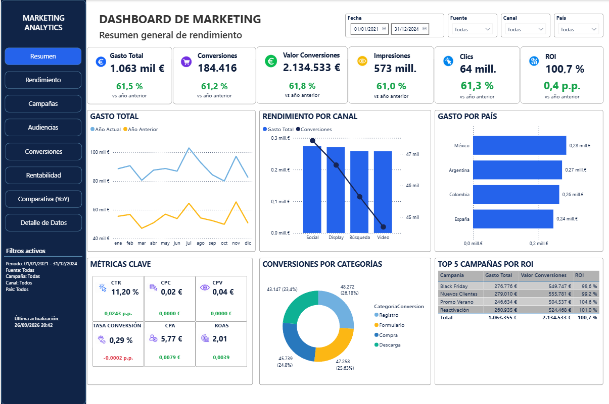
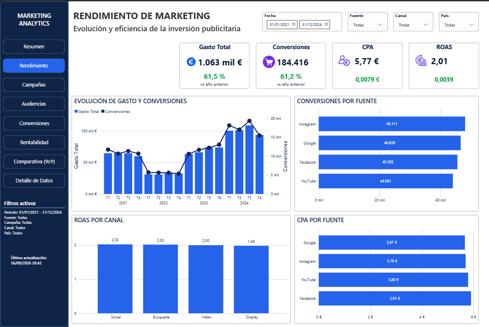
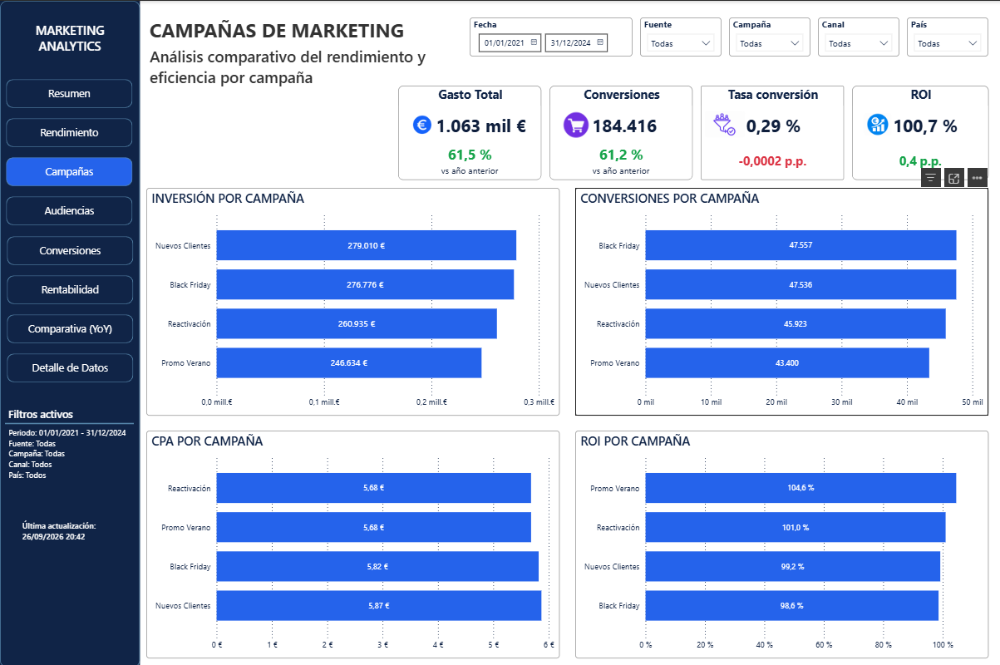
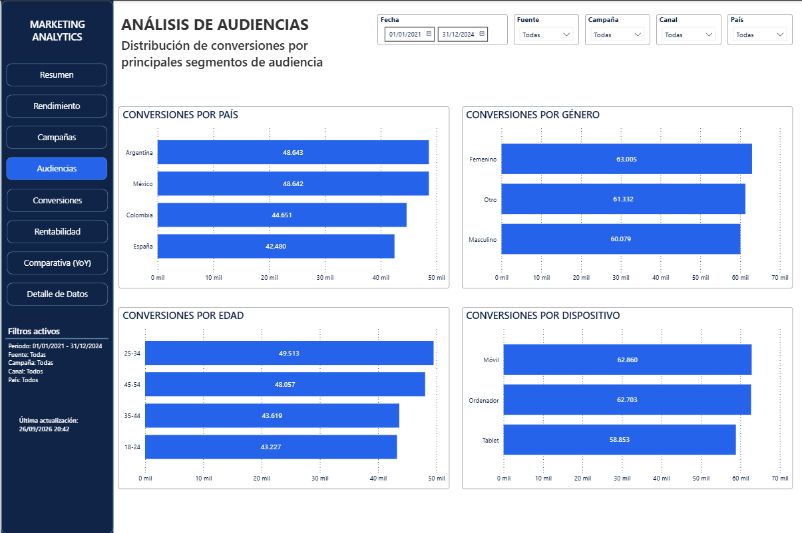
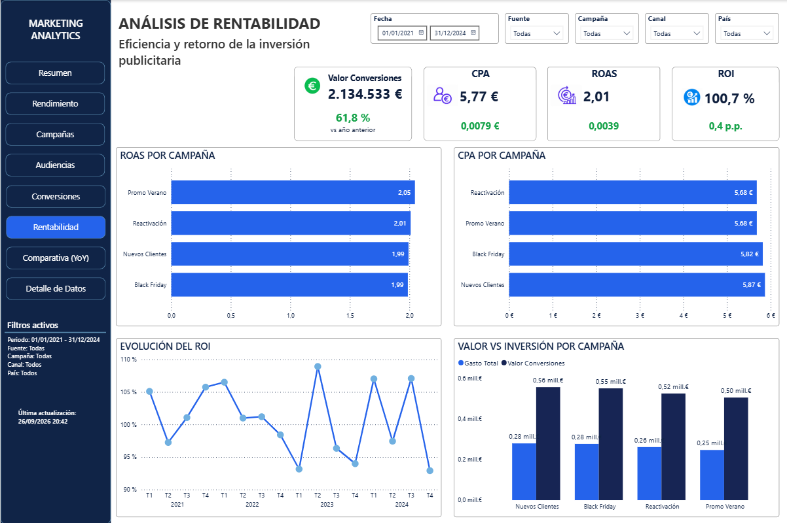
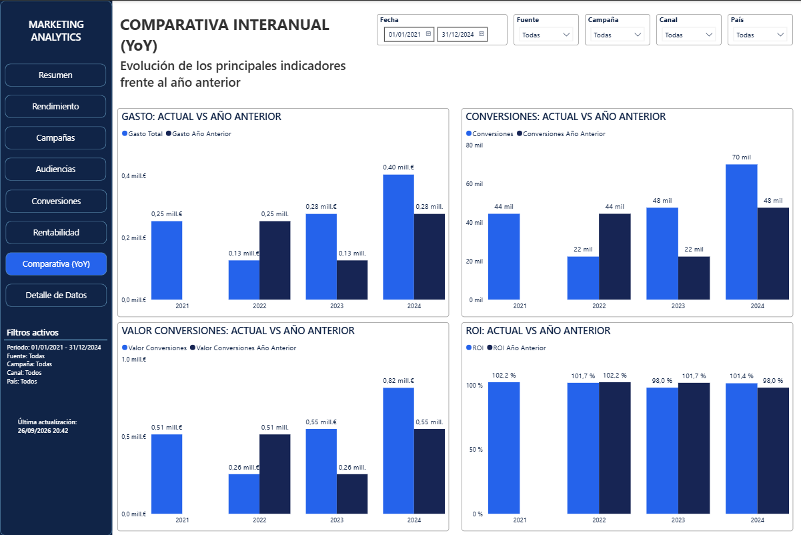

# Marketing Analytics — Power BI

Proyecto de **Data Analytics y Business Intelligence** orientado al análisis integral de campañas de marketing digital mediante **Power BI, Power Query y DAX**.

La solución transforma datos de campañas en un modelo dimensional que permite analizar inversión, rendimiento, audiencias, conversiones, eficiencia, rentabilidad y evolución interanual.

## Vista general



El informe está diseñado para pasar de una visión ejecutiva a análisis específicos por campaña, audiencia, conversión y rentabilidad, manteniendo un contexto común de filtros y navegación.

## Objetivo del proyecto

Construir una solución Power BI estructurada y mantenible capaz de responder preguntas como:

- ¿Cómo evoluciona la inversión publicitaria?
- ¿Qué campañas, canales y fuentes generan más conversiones?
- ¿Qué segmentos de audiencia presentan mayor actividad?
- ¿Cuál es el coste de generar resultados?
- ¿Qué retorno económico se obtiene de la inversión?
- ¿Cómo evolucionan los principales indicadores frente al año anterior?

## Dataset y alcance

El análisis cubre el periodo **2021–2024**.

Después del proceso de preparación:

- **2.120 registros** en la tabla de hechos.
- **19 campos** en `Hechos_Marketing`.
- Datos de campañas, grupos de anuncios, canales y fuentes.
- Segmentación por país, edad, género y dispositivo.
- Información de gasto, impresiones, clics, visualizaciones y conversiones.
- Valor asociado a las conversiones.
- Dimensión temporal específica para el análisis.

> **Nota sobre los datos:** el archivo fuente utilizado durante el desarrollo no se redistribuye en este repositorio. La estructura y el tratamiento aplicado se documentan para explicar el proceso analítico sin publicar el dataset original.

## Preparación de los datos

La preparación se realiza con **Power Query**.

El proceso incluye:

- Carga del archivo Excel mediante un parámetro de ruta.
- Promoción y normalización de encabezados.
- Tipado de columnas.
- Eliminación de elementos no analíticos.
- Filtrado de una fila de control incluida en el origen.
- Construcción de la tabla `Hechos_Marketing`.
- Generación de las dimensiones utilizadas por el modelo.
- Validación final de la carga.

## Modelo de datos

El proyecto utiliza un **modelo dimensional en estrella**.

`Hechos_Marketing` actúa como tabla central y se relaciona con once dimensiones:

- `DimCalendar`
- `DimCampania`
- `DimCanal`
- `DimCatConversion`
- `DimDispositivo`
- `DimEdad`
- `DimFuente`
- `DimGenero`
- `DimGrupoAnuncios`
- `DimNomConversión`
- `DimPais`

Las relaciones de negocio están configuradas como relaciones activas y con dirección de filtro única desde las dimensiones hacia la tabla de hechos.

`DimCalendar` funciona como dimensión temporal del modelo y sustenta el análisis por periodos y las comparativas interanuales.

Las medidas se centralizan en la tabla `_Medidas`, evitando dispersar la lógica analítica por el modelo.

## KPIs y métricas

### KPIs principales

- Gasto Total
- Impresiones
- Clics
- Conversiones
- Valor Conversiones

### Eficiencia

- CTR
- CPC
- CPV
- Tasa de Conversión
- CPA

### Rentabilidad

- ROAS
- ROI

### Comparativa temporal

Los principales indicadores disponen de medidas específicas del año anterior y variaciones **YoY**, permitiendo comparar el rendimiento entre periodos equivalentes.

## Dashboard

El informe está formado por **ocho páginas** conectadas mediante navegación lateral y una identidad visual común.

### 1. Resumen

Visión ejecutiva de los principales indicadores del proyecto, con evolución temporal y desgloses por canal, país, categoría de conversión y campaña.

### 2. Rendimiento



Análisis de la evolución de gasto y conversiones, conversiones por fuente y métricas de eficiencia como CPA y ROAS.

### 3. Campañas



Comparación del comportamiento de las campañas mediante inversión, conversiones, CPA y ROI.

### 4. Audiencias



Segmentación de las conversiones por país, género, edad y dispositivo.

### 5. Conversiones

Análisis de las conversiones por categoría y tipo, su evolución temporal y el valor económico asociado.

### 6. Rentabilidad



Evaluación de la eficiencia y del retorno de la inversión mediante Valor Conversiones, CPA, ROAS, ROI y comparaciones entre campañas.

### 7. Comparativa (YoY)



Comparación de los principales indicadores con el año anterior, incluyendo gasto, conversiones, valor de conversiones y ROI.

### 8. Detalle de Datos

Consulta detallada de los registros que sustentan los análisis agregados, manteniendo los filtros activos del informe.

## Principales capacidades analíticas

El proyecto permite:

- Analizar conjuntamente inversión, alcance, interacción y conversión.
- Evaluar la eficiencia mediante CTR, CPC, CPV, Tasa de Conversión y CPA.
- Analizar rentabilidad mediante ROAS y ROI.
- Comparar campañas, canales y fuentes.
- Segmentar resultados por características de audiencia.
- Analizar categorías y tipos de conversión.
- Estudiar la evolución temporal durante 2021–2024.
- Comparar indicadores frente al año anterior.
- Consultar el detalle de los datos que sustentan los resultados agregados.

El informe incorpora además un bloque dinámico de **Filtros activos**, que muestra el contexto aplicado de periodo, fuente, campaña, canal y país.

## Tecnologías utilizadas

- **Power BI Desktop** — modelado, DAX, visualización e informe.
- **Power Query** — carga, limpieza y transformación.
- **DAX** — KPIs, eficiencia, rentabilidad, comparativas YoY y medidas auxiliares.
- **Microsoft Excel** — formato del origen de datos.
- **Modelado dimensional** — arquitectura en estrella.
- **Git / GitHub** — publicación y documentación del proyecto.

## Estructura del repositorio

```text
.
├── README.md
├── Marketing_Analytics.pbix
├── docs/
│   ├── 1_Memoria_Proyecto_Marketing_Analytics.pdf
│   └── 4_Ficha_Portfolio_Proyecto_Marketing_Analytics.pdf
├── images/
│   ├── dashboard_resumen.png
│   ├── dashboard_rendimiento.png
│   ├── dashboard_campanas.png
│   ├── dashboard_audiencias.png
│   ├── dashboard_conversiones.png
│   ├── dashboard_rentabilidad.png
│   ├── dashboard_comparativa_yoy.png
│   └── dashboard_detalle_datos.png
└── data/
```

El archivo `Marketing_Analytics.pbix` contiene la versión final del informe y permite revisar en Power BI Desktop el modelo de datos, las relaciones, las medidas DAX y las ocho páginas del dashboard.

La carpeta `data` se mantiene sin el dataset original para evitar redistribuir el archivo fuente.

## Documentación

El repositorio incluye dos documentos orientados a presentar y explicar el proyecto:

- [Memoria del proyecto](docs/1_Memoria_Proyecto_Marketing_Analytics.pdf) — descripción completa del proyecto, preparación de datos, modelo, DAX, diseño analítico, resultados y conclusiones.
- [Ficha de Portfolio](docs/4_Ficha_Portfolio_Proyecto_Marketing_Analytics.pdf) — síntesis profesional del proyecto, capacidades, tecnologías, retos y competencias demostradas.

La documentación técnica y analítica completa se conserva como documentación maestra de trabajo y no se publica para mantener el repositorio enfocado.

## Competencias demostradas

- Power BI
- DAX
- Power Query
- Modelado dimensional
- ETL y preparación de datos
- Diseño de KPIs
- Análisis de marketing
- Análisis temporal y comparativa YoY
- Análisis de eficiencia y rentabilidad
- Segmentación de audiencias
- Visualización de datos
- Validación y calidad del dato
- Diseño de dashboards y experiencia de usuario
- Documentación técnica y analítica

## Limitaciones

- El análisis se limita al periodo 2021–2024 y a los datos disponibles en el origen.
- Las fuentes presentes en el dataset son Facebook, Google, Instagram y YouTube.
- El valor de conversión depende de la definición incluida en el origen y no debe interpretarse automáticamente como beneficio contable.
- ROI y ROAS se calculan con el gasto y el valor de conversión disponibles; no incorporan costes empresariales no presentes en el dataset.
- Las diferencias observadas entre segmentos son descriptivas y no demuestran causalidad.
- El proyecto no implementa un modelo de atribución multicanal.

## Posibles mejoras

Como evoluciones futuras podrían plantearse:

- Incorporar presupuestos y objetivos de campaña.
- Añadir nuevas plataformas si existen datos compatibles.
- Automatizar la adquisición de datos desde una fuente externa o API.
- Incorporar ingresos, margen u otros costes para ampliar el análisis económico.
- Desarrollar análisis de atribución si se dispone del recorrido completo de conversión.
- Publicar una versión controlada del informe en Power BI Service cuando el contexto lo permita.

Estas ampliaciones no forman parte de la versión actual del proyecto.

## Autor

**César Muñoz**

Proyecto desarrollado como parte de un portfolio profesional orientado a **Data Analytics y Business Intelligence**.
